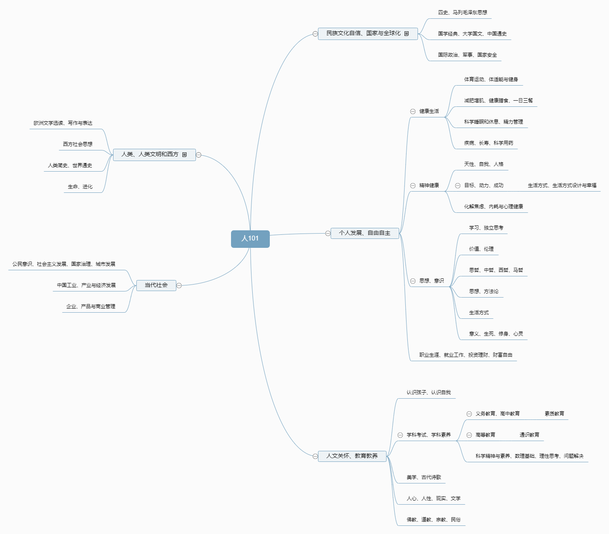

# TO BE A BETTER MAN

:alien:作为人类生活在这个地球上，我们需要很多指导。 
这是一份作为普通人类的知识框架，上帝会不会也用这个构建出不同的人。

作为人类，我们的认识领域还会有怎样的扩展边界。

# 全球、人类文明与发展
* [:man_cook: 人类、全球、宇宙](global.md)  
* [:rocket: 认知、思想、宗教、哲学、科学](science.md)   

# 社会、国家治理
* [:moneybag: 经济、产业、工业](economy.md)  
* [:man_cook: 历史、地方志](history.md)   
* [:man_cook: 政治、法律、国家治理](political.md)    
* [:man_cook: 军事、国家安全](war.md) 

# 当今个人生活
* [:kiss: 幸福地活着、了解自己、控制情绪](living.md)    
* [:leafy_green: 睡眠、膳食营养与健康](health.md)     
* [:weight_lifting_man: 科学健身与人体](run.md)    
* [:baby: 教育理论、儿童发展、亲子培养](child.md)    

# 中国实证
* [:earth_asia: 中国可持续发展](disease.md)
* [:earth_asia: 中国社会](society.md)
* [:earth_asia: 中国教育](edu.md)

# 工作与职业
* [:kiss: 个人财富、职业生涯](wealth.md)    
* [:speak_no_evil: 外语与表达](english.md)    
* [:computer: 计算机科学与技术](https://github.com/codefossil/javabook)    
* [:office: 企业、产品与管理](https://github.com/codefossil/productbook)    