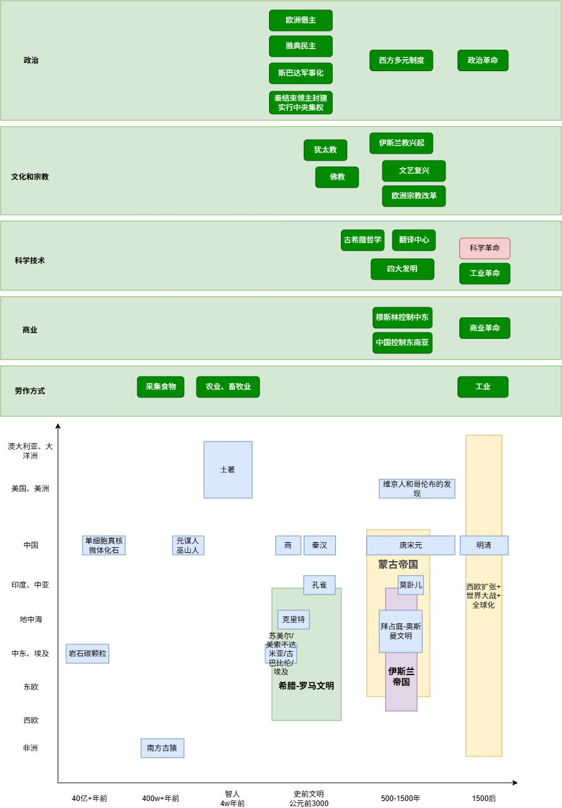

**跳出单一国家和学科的局限，以全球为视角或者大历史的视角来重新讲述人类和宇宙的故事。**

[全球通史 7th，斯塔夫里阿诺斯1998](https://book.douban.com/subject/36609039/)

打破了传统的“西方中心论”，把整个世界看作一个不可分割的有机整体，从全球的视角来考察不同文明的产生和发展。各大文明由于受限于技术和地理环境，从古典时期孤立发展，到地理大发现，西方霸权崛起，将世界连接到一起。

一个社会能否进步，关键看他**有没有机会**接触和学习临近文明的经验。落后就会挨打，封闭就会停滞。各文明社会文化发展起起落落，社会被彻底摧毁，也许意味着釜底抽薪，伺机也能打个翻身仗。

技术知识和物质层面大体积累，文明/文化/社会有兴衰、有起伏、有断裂。

[全球通史, 斯波德克Howard Spodek](https://book.douban.com/subject/30398015/)  

# 宇宙

[极简宇宙史](https://book.douban.com/subject/26697350/)

# 人类进化

[演化 跨越40亿年的生命记录](https://book.douban.com/subject/6750347/)

[复杂生命的起源](https://book.douban.com/subject/35221093/)

[医学史，卡斯蒂廖尼](https://book.douban.com/subject/24753678/)

[人类简史, 赫拉利](https://book.douban.com/subject/37295054/)  

[未来简史](https://book.douban.com/subject/37294999/)

# 全球治理

[世界政治：趋势与变革](https://book.douban.com/subject/30407289/)  

[今日简史](https://book.douban.com/subject/37295025/)  

[以自由看待发展, 阿马蒂亚·森02](https://book.douban.com/subject/1084434/)  

# 认知

[20世纪思想史](https://book.douban.com/subject/34449288/)

[科学通史](https://book.douban.com/subject/36223179/)

[世界科学技术通史](https://book.douban.com/subject/35217126/)

[宗教思想史](https://book.douban.com/subject/1176241/)